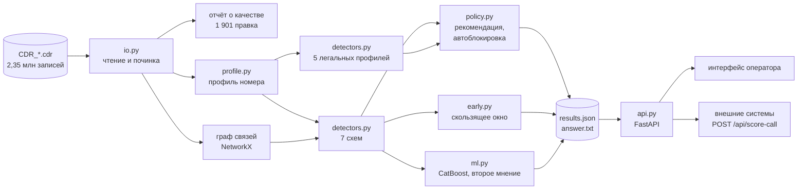

# Архитектура и технологии

## 1. Задача и принципы

Найти номера, участвующие в схемах мошенничества и массовых прозвонов, по записям коммутатора (CDR):
тип вызова, IMSI и номер A, номер B, время, длительность, номер переадресации C. Содержимого разговора нет.

Три принципа, из которых следует всё остальное:

1. **Объяснимость важнее сложности.** Оператору бесполезен ответ «0,87». Балл строится как сумма
   вкладов понятных факторов, поэтому его можно отладить и защитить перед регулятором.
2. **Ложная блокировка дороже пропуска.** Легальные массовые источники распознаются отдельно и явно,
   а автоблокировка — отдельное решение со своими условиями.
3. **Ничего не теряется молча.** Каждая исправленная строка входных данных учтена в отчёте.

## 2. Схема



## 3. Чтение и починка данных (`io.py`)

Файлы читаются целиком и разбираются векторно (pandas). Номера читаются как строки, иначе теряется
ведущий ноль кодов 025–027.

| Ошибка | Строк | Что делаем |
|---|---|---|
| Код страны в номере (`+7`, `7`, `8`) | 231 | приводим к 10 цифрам |
| Испорченный код оператора (`777…`) | 226 | восстанавливаем по IMSI, а для номера B — по совпадению хвоста с единственным известным номером |
| Пропущено поле длительности | 222 | длительность неизвестна; номер C распознаётся по виду и остаётся на месте |
| IMSI не из 15 цифр | 211 | IMSI не используем (иначе обрезанный IMSI выглядел бы как «вторая SIM») |
| Пустой номер | 206 | строка исключается |
| Несуществующая или неполная дата | 183 | берём время соседней записи того же файла (файлы упорядочены по времени) |
| Неизвестный тип вызова (`AA`, `00`, `07`) | 153 | восстанавливаем: есть C — переадресация, есть IMSI — исходящий, иначе входящий |
| Лишние поля | 148 | отбрасываем хвост |
| Длительность не число или отрицательная | 140 | длительность неизвестна |
| Дата в формате `YYYY-MM-DD hh:mm:ss` | 46 | приводим |
| Длительность больше суток | 45 | длительность неизвестна |
| Тип без ведущего нуля | 43 | дополняем |
| Дробная длительность | 37 | округляем |
| Код оператора не восстановлен | 10 | номер остаётся как есть и не участвует в выводах |

Неизвестная длительность — это именно «неизвестно», а не ноль: иначе испорченные строки стали бы
«сбросами» и исказили признаки.

## 4. Профиль номера (`profile.py`)

Одна строка на номер за окно наблюдения: число исходящих, число и доля уникальных собеседников,
доли вызовов без ответа и сбросов на 0–2 с, медиана длительности, доля ночных вызовов и вызовов
в выходные, часы и дни активности, интервал жизни, число IMSI, входящие, роль в переадресациях.

Важное наблюдение о данных: обычные абоненты здесь почти всегда звонят новому номеру, поэтому
«уникальные собеседники» сами по себе ничего не значат. Все детекторы опираются на сочетания признаков.

## 5. Детекторы схем (`detectors.py`)

| Схема | Что выдаёт схему | Как отличается от легального двойника |
|---|---|---|
| S1 Wangiri | ≥100 вызовов за часы, ≥80% сброшены на 0–2 с; перезвоны жертв записаны типом 03 и уходят на один номер C | у оповещения ЖКХ медиана разговора 26 с, у Wangiri — 0 |
| S2 Робот | медианный шаг между соседними набранными номерами ≤5 (у обычного источника — миллионы); номера с пересекающимися диапазонами объединяются в связку, диапазон связки покрыт почти без пропусков | банк и ЖКХ звонят по случайной базе |
| S3 SIM-box | ≥50 вызовов, входящих ≤3%, все собеседники разные, сбросов не больше 2%, вызовы не накладываются, работает ≥8 ч подряд | у обычного абонента входящих десятки процентов и ~9% сбросов |
| S4 Клон SIM | у номера ≥3 разных IMSI (после отбраковки обрезанных), есть одновременные вызовы с разных SIM | — |
| S5 Цепочка | серия записей 03 от одного звонящего с шагом ≤2 с, где C предыдущей равен B следующей; узлы — все номера маршрута | у горячей линии 10–30 номеров компании переадресуют на один номер, без цепочек |
| S6 Карусель | компонента графа связей из 3–15 номеров: ≥95% вызовов внутри группы, длительности в полосе 8–45 с | у диспетчерской круг контактов открыт наружу |
| S7 Вишинг | мошенник: ≥8 вызовов, ≥80% длиной 6–30 мин, входящих не больше одного; спуф-номера: «городские», только короткие вызовы, звонили ≥2 жертвам этого мошенника за ≤12 ч до его звонка | — |

Детекторы устойчивы к единичным посторонним записям (например, к случайному входящему на SIM шлюза
или к номеру B с невосстановленным кодом): вместо минимума и максимума используются медианы и квантили,
вместо строгого «ноль входящих» — доля.

### Легальные источники

| Профиль | Признаки распознавания |
|---|---|
| D1 Колл-центр | городской номер, вызовы только в рабочие часы (в выгрузке 9:00–20:00 по будням), 20–50% без ответа |
| D2 Банковские оповещения | вызовы в 3–4 фиксированных часа, не меньше трёх дней подряд, медиана 6–20 с, номера не подряд |
| D3 Ночная диспетчерская | ≥40% вызовов ночью, не больше 35% уникальных собеседников, много входящих, группа не замкнута |
| D4 Горячая линия | ≥100 переадресаций на номер от 8–40 номеров, медиана разговора ≥30 с |
| D5 Оповещение ЖКХ / МЧС | городской номер, все вызовы за ≤3 ч, входящих нет, номера не подряд, медиана ≥15 с |

Распознанный легальный источник получает собственную карточку с двумя группами факторов: что
настораживает (плюс) и что снимает подозрение (минус). Если номер подходит и под схему, и под легальный
профиль, он уходит на ручную проверку и не блокируется автоматически. На текущей выгрузке таких случаев нет.

## 6. Балл

Каждый фактор имеет вес и силу от 0 до 1; вклад фактора = вес × сила, балл = сумма вкладов, от 0 до 100.
Пример карточки Wangiri-номера:

```
792 вызова за 2,4 ч                                           +25
100% вызовов — сброс на 0–2 секунде                           +35
51 жертва перезвонила — вызов ушёл на номер +7 499 ***-**-62  +25
Номер «жил» всего 2,4 ч                                       +15
                                                       балл   100
```

Номер попадает в ответ при балле схемы от 60. Все пороги лежат в `config.py`.

## 7. Политика реагирования (`policy.py`)

| Условие | Действие |
|---|---|
| Номер экстренной службы (112, 101–104) или из белого списка оператора | никогда не блокировать |
| Вызов на экстренный номер от любого абонента, в том числе заблокированного | пропустить до скоринга |
| Схема без легального применения (S1 приманка, S2, S3, S4), балл ≥90, факторов ≥3, нет совпадения с легальным профилем | автоблокировка |
| Балл ≥75 | пометить абоненту; решение о блокировке за человеком |
| Балл 60–74 или совпадение с легальным профилем | на проверку аналитику |
| Распознан легальный источник | пропускать |

Ответ на вопрос из ТЗ «что произойдёт, если система заблокирует вызов скорой помощи»: этого
не произойдёт по построению, потому что проверка экстренного номера стоит перед скорингом и не
зависит ни от балла, ни от чёрного списка. Поведение закреплено тестами (`tests/test_scoring.py`).

Жертва, которая перезванивает на номер схемы, не блокируется: система советует предупредить её
до соединения.

## 8. Раннее обнаружение (`early.py`)

Детекторы видят всё окно наблюдения. Чтобы показать, как решение работает в потоке, два правила
пересчитаны скользящим окном по последним вызовам номера.

| Схема | Правило | Тревога | Вызовов схемы после тревоги | Тревог на посторонних номерах |
|---|---|---|---|---|
| Wangiri | из последних 20 вызовов ≥90% сброшены на 0–2 с | через 20 вызовов, медиана 3,7 мин | 96% | 0 |
| Робот | 10 набранных подряд разных номеров умещаются в диапазон из 100 | через 10 вызовов, медиана 48 с | 99% | 0 |

Размеры окон — наименьшие, при которых на всех 2,35 млн записей нет ни одной тревоги на постороннем номере.

## 9. Второй контур: модель (`ml.py`)

Разметки в данных нет, поэтому классификатор CatBoost учится на находках детекторов, но получает
только 17 признаков общего профиля — без графа связей и без правил схем. Перекрёстная проверка идёт
по группам (StratifiedGroupKFold): номера одной связки или карусели не попадают одновременно
в обучение и в проверку.

- Оценено 12 114 номеров (от 20 исходящих).
- Подтверждены 353 находки детекторов из 353; расхождений нет; ни один легальный источник не назван фродом.
- «Экзамен на новую схему»: если убрать схему из обучения целиком, модель всё равно узнаёт Wangiri,
  робота, SIM-box и клон SIM (100%), но не узнаёт карусель и вишинг (0%). Вывод: «взрывные» схемы
  видны по профилю, а «тихие» — только по графу связей, и специальные детекторы для них необходимы.

Вероятность по модели показана в карточке номера как «второе мнение». На решение она не влияет:
расхождение контуров — повод для ручной проверки.

## 10. API (`api.py`)

| Метод | Назначение |
|---|---|
| `GET /` | интерфейс оператора |
| `GET /api/health` | состояние сервиса |
| `GET /api/results` | полный результат последнего расчёта |
| `GET /api/numbers?scheme=S3&min_score=90` | номера в ответе |
| `GET /api/number/{msisdn}` | карточка номера: балл, факторы, решение |
| `POST /api/score-call` | скоринг одного вызова по «конверту» |

```bash
curl -X POST http://127.0.0.1:8000/api/score-call -H "Content-Type: application/json" \
     -d '{"type":"02","a":"8999946341","b":"103","dur":40}'
# → "decision": {"action": "never_block", "autoblock": false, ...}
```

Описание в формате OpenAPI доступно по адресу `/docs`.

## 11. Интерфейс (`web/`)

Одна страница без сборщиков и сторонних библиотек: HTML, CSS, JavaScript; графики нарисованы в SVG.
Разделы: обзор, номера в ответе, легальные источники, проверка одного вызова, описание метода.
Карточка номера: балл, факторы с вкладом, рекомендация, автоблокировка, активность по часам,
граф связей группы, примеры исходных записей. Светлая и тёмная тема, работает на телефоне.

Номера по умолчанию маскируются (`+7 499 ***-**-12`); полный вид включается отдельной кнопкой.

Интерфейс собирается в один файл `dist/index.html` с данными внутри — его можно открыть без сервера
или выложить на любой статический хостинг.

## 12. Технологии

| Слой | Технологии |
|---|---|
| Обработка данных | Python 3.11, pandas, NumPy |
| Граф связей | NetworkX |
| Модель | CatBoost, scikit-learn (перекрёстная проверка по группам), SHAP-значения CatBoost |
| Сервис | FastAPI, Pydantic, Uvicorn |
| Интерфейс | HTML, CSS, JavaScript, SVG |
| Проверка | pytest, 27 тестов |

## 13. Информационная безопасность

- Используются только метаданные вызова; содержимое разговоров не нужно и не запрашивается.
- Номера в интерфейсе маскируются по умолчанию.
- Сервис только читает результаты расчёта; автоблокировка — это рекомендация для внешней системы,
  сам сервис ничего не блокирует.
- Интерфейс не подгружает сторонний код: скрипты и стили свои, внешние только шрифты.
- Входные данные проверяются: формат полей в API задан схемой Pydantic.

## 14. Ограничения и развитие

- В CDR нет IMEI и идентификатора соты, поэтому SIM-карты шлюзов оцениваются по одной. С этими полями
  их можно объединять в устройства и находить шлюз по одной пойманной SIM.
- Профиль считается по окну в пять дней. Для промышленной работы тот же расчёт переносится на поток
  (скользящие окна на номер); для Wangiri и робота это уже проверено в `early.py`.
- Пороги подобраны по описанию сценариев и одной выгрузке. В эксплуатации их нужно сверять
  с обратной связью от аналитиков: подтверждённые и отклонённые находки становятся разметкой,
  и модель из второго контура переходит из роли проверяющего в роль полноценного участника.
- Спуфинг определяется по поведению номера, а не по сигнализации. Данные сигнального уровня
  (подлинность A-номера) закрыли бы этот класс точнее.
